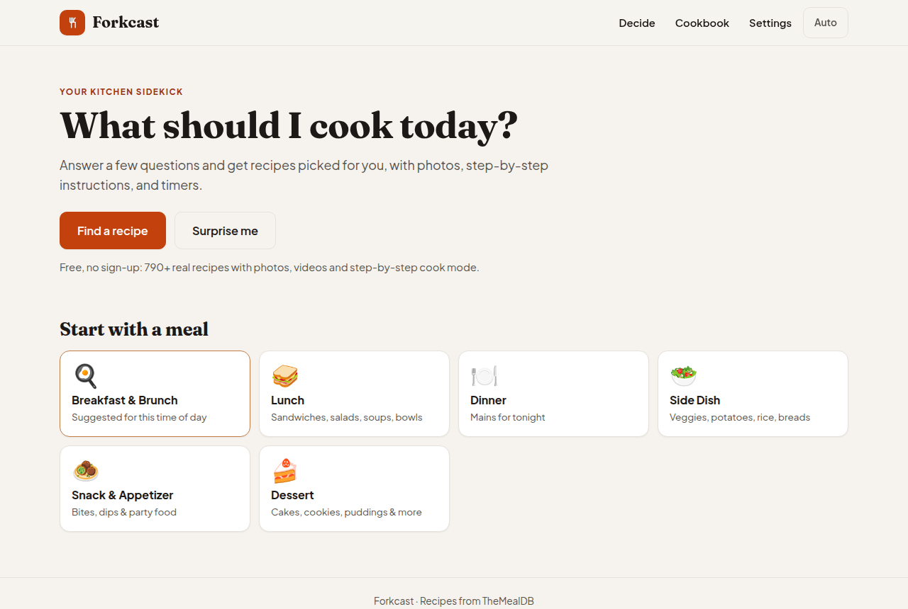
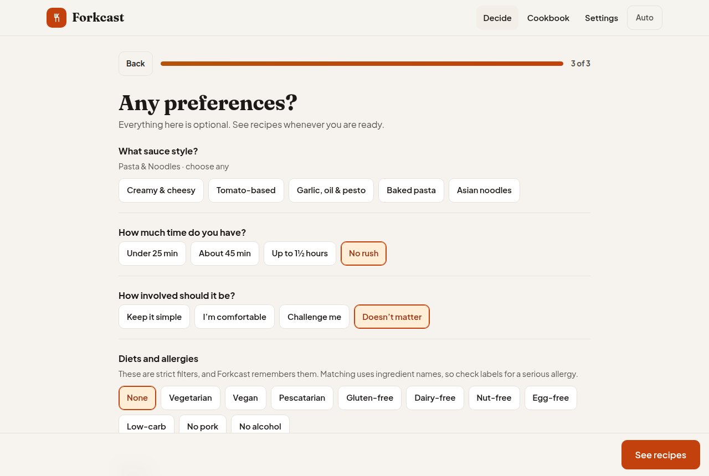
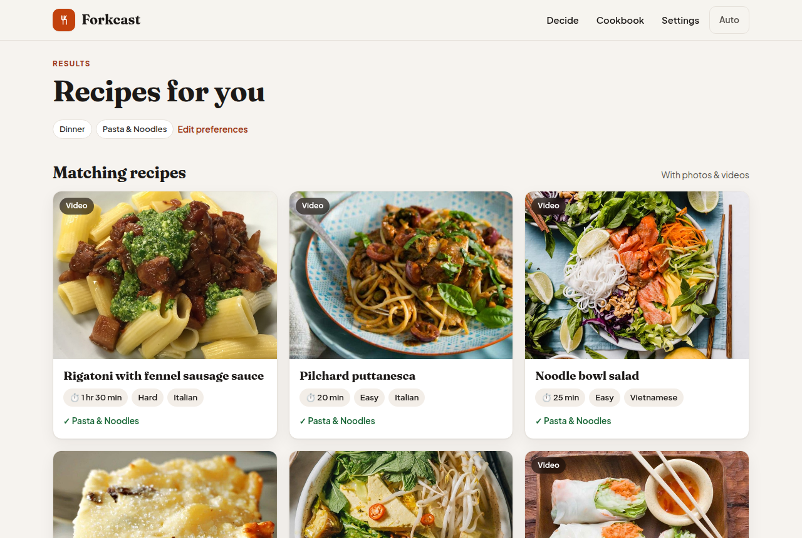
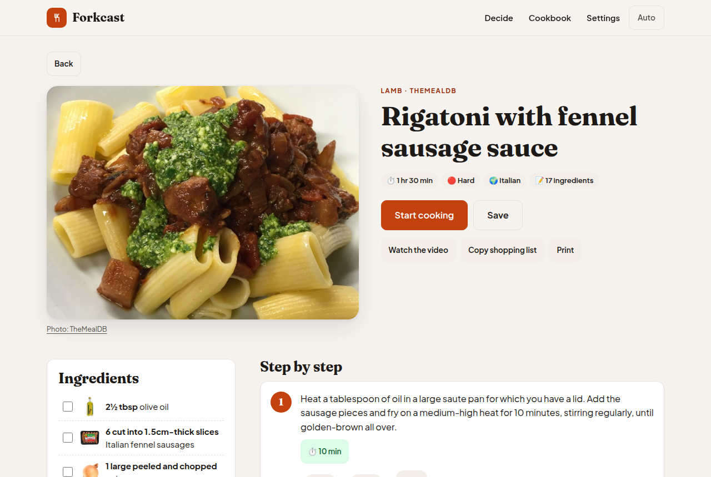
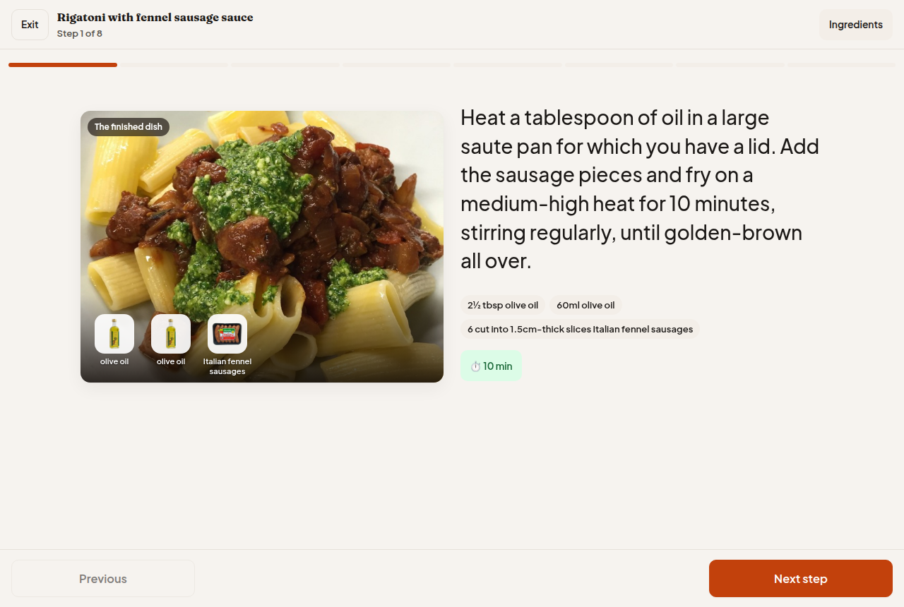

# Forkcast

**Decide what to cook, then cook it step by step.**

[Live site](https://process631.github.io/forkcast/) · [How it picks recipes](#how-it-works) · [Run it locally](#setup)

Forkcast is a static web app for the moment you open the fridge and still do not know what to make. You choose a meal and a kind of food, answer a few optional questions, and get a short list of real recipes with the reasons each one fits. Pick one and it becomes a checklist: ingredient photos, numbered steps, one-tap timers, and a full-screen cook mode that keeps the screen awake.

It is free, has no account, and runs entirely in the browser. The catalog is 790+ recipes from [TheMealDB](https://www.themealdb.com), with photos and videos.



## Features

- **Guided choices.** Breakfast, lunch, dinner, sides, snacks, or dessert, then a kind of food that changes with the meal (pasta, chicken, sandwiches, soups, sweet treats, and more).
- **One preferences page.** After the meal and the kind of food, time, skill, diet, flavor, cuisine, and ingredients sit on a single optional screen. **See recipes** stays on screen the whole time.
- **A short list with reasons.** Each card shows a photo, time, difficulty, cuisine, and why it matched. "Show me different options" shuffles in fresh picks and keeps near-duplicates apart.
- **Cook the recipe.** Check off ingredients, see which ones each step uses, start a timer from a duration in the instructions ("simmer 20 minutes"), watch the video, copy a shopping list, or print.
- **Cook mode.** One step at a time, large type, keyboard and swipe navigation, and a screen wake lock on secure origins.
- **Cookbook.** Saved recipes and a recent-history list stay in this browser.
- **Light, dark, or system theme.** The layout works on a phone and on a desktop.

Allergy and diet filters match ingredient names. They are a convenience, not a substitute for reading labels.

## Tech stack

| Piece | Choice |
|---|---|
| UI | React 19, TypeScript, Vite |
| Tests | Vitest, jsdom |
| Data | [TheMealDB](https://www.themealdb.com/api.php) JSON API |
| Storage | IndexedDB for the catalog (7 days), localStorage and sessionStorage for cookbook, diets, answers, and timers |
| Hosting | Static files on GitHub Pages (`.github/workflows/deploy.yml`) |

There is no server. TheMealDB's public test key is the digit `1`, which their docs publish for personal and educational client-side use. It is not a secret, and this app does not have any other API key. See [`.env.example`](.env.example).

## How it works

The address bar uses a hash router (`#/plan`, `#/recipe/mdb-52772`), so the built site works from a subpath such as GitHub Pages' `/forkcast/` without a server rewrite. Asset URLs are relative (`base: './'` in `vite.config.ts`).

```
Home or "Decide"
  → meal
  → kind of food          src/data/taxonomy.ts
  → one preferences page  src/lib/questions.ts
  → ranked recipes        src/lib/match.ts
  → recipe page
  → cook mode
```

1. **Load the catalog.** `src/lib/mealdb.ts` requests TheMealDB once per letter, normalizes each meal into steps, timers, and a time and difficulty estimate (`src/lib/parse.ts`), and caches the raw meals in IndexedDB for a week.
2. **Hard filters.** Diets and allergies (vegetarian, vegan, pescatarian, gluten-free, dairy-free, nut-free, egg-free, low-carb, no pork, no alcohol) and the "avoid" list remove recipes by ingredient name (`src/lib/diet.ts`).
3. **Category rules.** Each kind of food has keyword and category rules. If too few recipes match, the closest ones are still shown and labeled "Close match".
4. **Score.** A recipe scores for meal fit, the follow-up answer, flavor, cuisine, ingredients to use up, and how its estimated time and skill compare with your answers. A little deterministic randomness makes "Show me different options" return a new set.
5. **Variety.** Titles that are almost the same (Fettuccine Alfredo and Fettucine alfredo) are not shown together.

Time and difficulty come from the instructions: durations such as "simmer 20 minutes" or "chill overnight", step count, ingredient count, and techniques such as kneading or deep-frying.

Links and images from the API are accepted only as `http` or `https` (image data URLs and blob URLs are also allowed for pictures). A YouTube embed is built only from an 11-character video id.

## Setup

You need [Node.js](https://nodejs.org) 20 or newer. These commands were run on Node 22.

```bash
npm ci
npm run dev
```

Open <http://localhost:5173>.

`npm ci` installs the lockfile exactly. `npm install` also works. The only optional setting is the dev server port, which defaults to `5173`. Copy [`.env.example`](.env.example) to `.env` and set `PORT`, or pass it in the shell (`PORT=5174 npm run dev`).

| Command | What it does |
|---|---|
| `npm run dev` | Dev server with live reload |
| `npm run dev:host` | Same server, reachable from other devices on your network |
| `npm test` | Unit tests (parsing, diets, matching, URL safety) |
| `npm run typecheck` | TypeScript with no emit |
| `npm run build` | Type-check and write a static site to `dist/` |
| `npm run preview` | Serve the production build locally |

### Open it on your phone

The live site works on any phone. To try a local copy:

1. Run `npm run dev:host`.
2. Open the **Network** URL Vite prints. The phone has to be on the same Wi-Fi.
3. If the page does not load, allow Node.js through the firewall on private networks.

Cook mode can keep the screen awake on `https` and on `localhost`. A plain `http` address on the local network cannot use the Wake Lock API. The live site can.

### Publishing

Every push to `main` runs the GitHub Pages workflow: `npm ci`, `npm test`, `npm run build`, then deploy `dist/`. The workflow uses Node 24.

## Usage

1. On the home page, choose **Find a recipe**, **Surprise me**, or a meal card. The highlighted meal follows the time of day.
2. Pick a kind of food. Open **More ideas** if the first row is not it.
3. On **Any preferences?**, set only what matters. **See recipes** is fixed to the bottom of the screen.
4. Open a recipe from the results. **Start cooking** enters cook mode. Arrow keys, the space bar, or a swipe move between steps. Escape leaves cook mode.
5. **Save** stores the recipe in the cookbook. Settings can refresh the downloaded catalog or clear the cookbook. Both live only in this browser.









## Project structure

```
src/
  data/taxonomy.ts       meals, categories, follow-up questions, cuisines, diets
  lib/
    mealdb.ts            TheMealDB catalog, normalized and cached for 7 days
    parse.ts             instructions → steps, timers, time and difficulty
    diet.ts              diet and allergy checks
    match.ts             recommendation engine
    questions.ts         which question screens to show
    urls.ts              http(s) links, safe image sources, YouTube ids
    store.ts             answers, results, cookbook, timers
    storage.ts           localStorage, sessionStorage, IndexedDB
    useRecipe.ts         one recipe from the catalog, or a saved copy when offline
  components/            Home, Wizard, Results, RecipePage, CookMode, Cookbook, Settings
  router.ts              hash router
.github/workflows/       test, build, and deploy to GitHub Pages
PLAN.md                  original design notes, including the removed AI chef
```

## Earlier AI chef

An earlier version could write recipes and pictures with Google Gemini, either by copy-and-paste with the Gemini app or with an API key typed into Settings. That key stayed in the browser and was never part of this repository. Those features were removed to keep the app a simple catalog browser. The full version is git commit `f14113e`. On startup, the current app deletes any leftover `forkcast.settings` value so an old key is not left in localStorage.

## Troubleshooting

- **Edits do not show up.** On Windows, Vite's file watcher sometimes misses a quick save. Stop the dev server and run `npm run dev` again.
- **"Couldn't load the recipe library."** The first load needs a network connection to TheMealDB. After that, the catalog is cached for a week. Use Settings → Refresh recipe library to force a new download.
- **A saved recipe from the old AI version.** It still opens from the cookbook when a copy is stored on this device. New recommendations come only from TheMealDB.

## Credits and license

The application code is [MIT](LICENSE). Recipes, photos, ingredient pictures, and videos are fetched at runtime from [TheMealDB](https://www.themealdb.com) and stay under their terms. TheMealDB's free developer key is for personal and educational use.
